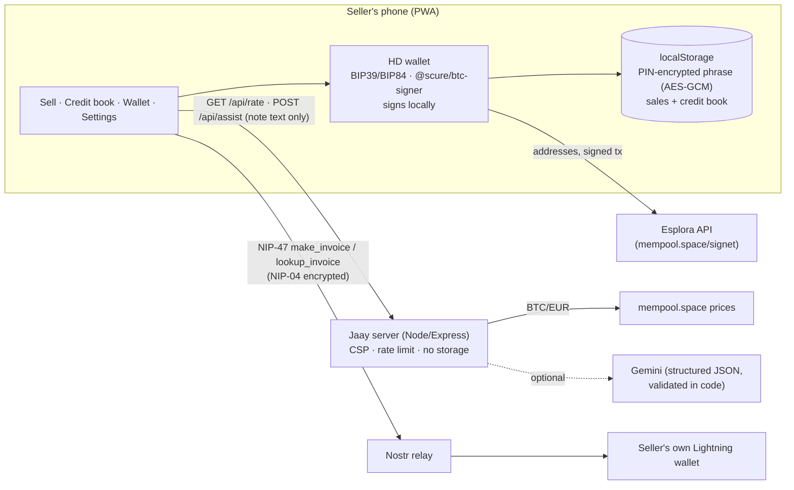

# Jaay: Bitcoin point of sale and credit book for market sellers

*Jaay* means "sell" in Wolof. Jaay is a phone app for small traders in Dakar's markets: you type a price in **CFA francs**, the customer scans a QR code and pays in **bitcoin** (on-chain or **Lightning**), and the sale is recorded. A **credit book** ("carnet de dettes") tracks who owes what, and you can write notes in plain French or English: *"Vendu 3 sacs de riz à 15000"*, *"Awa doit 2500 pour le poisson"*.

> **Test network only.** Jaay runs on Bitcoin **signet**: test coins with no value. Do not send real bitcoin to it.

## The problem
- Many sellers already sell on credit and track it in a paper notebook or in their head. Debts are forgotten and disputes are common.
- Mobile money fees eat into thin margins, and many cross-border customers can't use local mobile money.
- Bitcoin wallets show prices in BTC or USD and assume fast data; sellers think in CFA and often have slow, expensive mobile data.

## What Jaay does
| | |
|---|---|
| **Sell in CFA** | Keypad in FCFA; converted to sats live. XOF is pegged to the euro (655.957 XOF = 1 EUR), so only BTC/EUR is needed. |
| **Get paid** | A QR code for a fresh signet address (BIP21 with amount) or a **Lightning invoice** from the seller's own wallet via **Nostr Wallet Connect (NIP-47)**. Jaay watches for the payment and shows a big ✔ "Payé!" with a vibration. |
| **Your keys, your phone** | A real HD wallet: BIP39 12-word phrase, BIP84 native segwit, built with the audited `@scure` libraries. The phrase is encrypted with your PIN (PBKDF2-SHA256, 310k rounds + AES-256-GCM) and never leaves the device. Send, receive and check your balance. |
| **Credit book** | Who owes what, with a running total. Turn a debt into a payment request with one tap, or record a cash repayment. |
| **Plain-language notes** | An AI reads "Vendu 2 sacs à 10 000" or "Moussa a payé 1000" and does the right thing. It works **without AI** too: an offline parser handles French and English, so the app never depends on it. |
| **Made for cheap phones** | ~280 KB app, installs to the home screen (PWA), opens offline, big buttons, French by default with English available, light and dark mode. |

## Try it
- **Live:** https://jaay-r9za.onrender.com (signet). Tap *Créer mon portefeuille*, write down the 12 words, choose a PIN, sell.
- **Test coins:** get signet bitcoin from https://signetfaucet.com/ and send them to the address in *Portefeuille*.
- **Lightning (optional):** in *Réglages*, paste a `nostr+walletconnect://…` string from a wallet that supports NWC (e.g. Alby Hub, Coinos) set to a test network.

## Run it (one command)
```bash
npm install && npm start          # http://localhost:3000
```
or with Docker:
```bash
docker build -t jaay . && docker run -p 3000:3000 jaay
```
Optional: copy `.env.example` to `.env` and set `GEMINI_API_KEY` to let an AI read notes; without it the offline parser is used.

Tests: `npm test` (BIP84 test vectors, PIN encryption, coin selection and signing, CFA conversion, note parsing, server security headers, rate caching, AI-output validation).

## Architecture


**What the server never sees:** keys, the recovery phrase, balances, the sales history or the credit book. It only serves the app, a cached exchange rate, and (optionally) reads a single note.

## Security by design
- **Threat model.** Lost or stolen phone → the phrase is encrypted with the PIN, and the app auto-locks after 5 minutes. Malicious server → it holds no keys and is not in the signing path. Network observer → HTTPS only, and only public addresses are queried. Prompt injection in notes → the AI output must match a strict schema, is re-validated in code (kind, amount ≤ 10M FCFA, customer required for credit), and the AI can never move money.
- **Least privilege.** Lightning uses an NWC connection the seller creates and can revoke in their own wallet. Jaay only calls `make_invoice`, `lookup_invoice` and `get_info`, so set a budget of 0 for sending.
- **Safe defaults.** Strict Content-Security-Policy (no inline scripts), `nosniff`, `no-referrer`, 4 KB JSON limit, per-IP rate limit, no request bodies in logs, mainnet addresses rejected, dust-safe change handling.
- **Proven libraries.** `@scure/bip39`, `@scure/bip32`, `@scure/btc-signer`, `@noble/hashes` (audited, pure JS) and `nostr-tools`.
- **No false "paid".** A payment only counts if it is a *new* transaction to that request's address, paying at least 98% of the amount.

## Who it's for and how we'd measure impact
The primary user is a market seller (cloth, fish, grains) with a mid-range Android phone. What we'd track in a pilot:
- sales recorded per seller per week
- share of credit repaid within 30 days
- time to complete a payment
- payments that fail or time out

## Limitations (honest)
- Signet only. Mainnet needs an external security review and a backup-recovery drill with real users.
- The on-chain wallet scans a small address gap (5); heavy users would need an indexer or descriptor sync.
- Lightning depends on the seller having an NWC-capable wallet.
- No Wolof interface yet; French and English only.

## Next
- Wolof voice notes.
- SMS or Nostr DM reminders to customers who owe money.
- Shared credit books for family businesses.
- Lightning-address tips.
- A mainnet beta with a local partner.

## License
MIT
